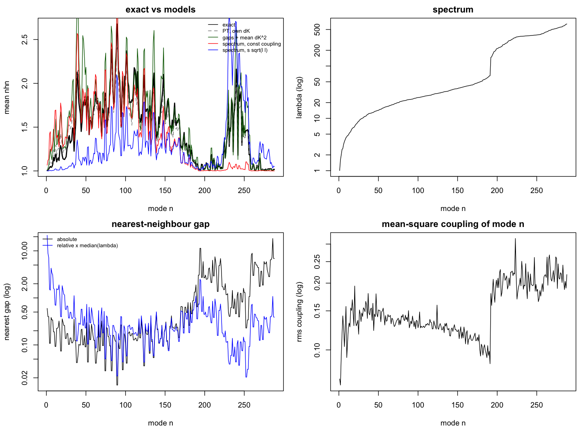
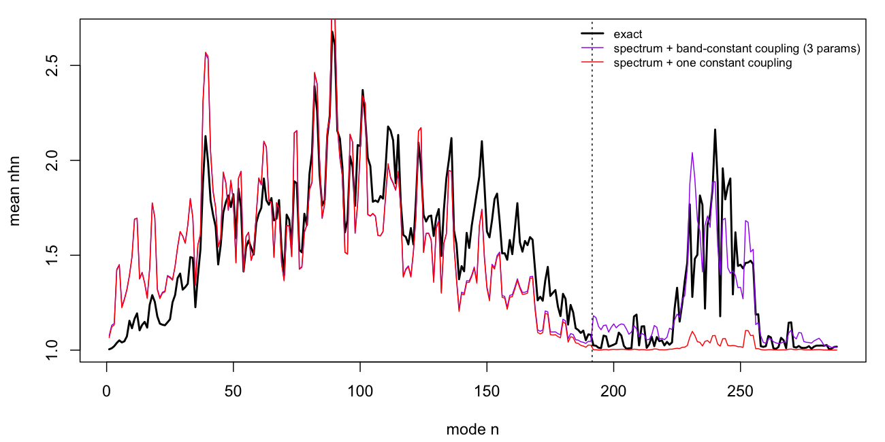

# Comparing the motions of two proteins

Explorations behind a review of penm's `delta_motion_*` measures, and of how
normal modes change under mutation. Nothing here is package code.

Run every script from the package root, in this order (the later two read
`nhn_scan.rds`):

```bash
Rscript dev/explorations/motion_comparisons/motion_identities.R
Rscript dev/explorations/motion_comparisons/complement.R
Rscript dev/explorations/motion_comparisons/nhn_scan.R      # ~25 s on 10 cores
Rscript dev/explorations/motion_comparisons/nhn_explain.R
Rscript dev/explorations/motion_comparisons/nhn_bands.R
```

Each script's printed output is saved beside it as `<script>.out.txt`.

## Files

| file | what it does |
|---|---|
| `motion_comparisons_report.tex` (+ `.pdf`) | the report: penm's motion measures, the literature, eigenvector and eigenvalue changes, complement networks, the scan |
| `metrics_report.tex` (+ `.pdf`) | the second report: distribution metrics (Wasserstein-2, KL and other spectral divergences, Frobenius, marginal sums) decomposed by site and by mode, with figures |
| `metrics_scan.R` | computes those metrics and their decompositions for every mutant of the scan; `metrics_scan.rds` (run time ~2 min) |
| `metrics_plots.R` | the figures `metrics_by_site.png`, `metrics_by_mode.png`, `metrics_examples.png`, `metrics_totals.png`, `metrics_correlations.png`, and the numbers in `metrics_plots.out.txt` |
| `motion_identities.R` | identities among the `delta_motion_*` measures, on one genm mutant (site 11, letter 1) |
| `complement.R` | whether a network and its complement share eigenvectors, for GNM and ANM |
| `nhn_scan.R` | complete single-point genm scan of 2acy (882 mutants); per mutant, `nhn` and the mutant Hessian in the wt mode basis |
| `nhn_explain.R` | mean `nhn` per mode against perturbative and spectrum-only models; `nhn_explain.png` |
| `nhn_bands.R` | the spectrum-only model with one coupling scale per pair of spectral bands; `nhn_bands.png` |
| `nhn_scan.rds` | the scan's results (8 MB) |
| `nhn_explain.rds`, `nhn_bands_pred.rds` | the model predictions plotted in the figures |

The wild type throughout is the genm vignette's: 2acy, `node = "ca"`,
`model = "ming_wall"`, `d_max = 10.5`, `d_max_graph = 14`, `ensemble = 1`,
`alphabet_size = 10`, `mut_dl_sigma = 0.3`, `mut_sd_min = 2`.

## Results

### Identities among the motion measures (`motion_identities.R`)

On one genm mutant:

- `delta_motion_dhn` is exactly ½ ln(1 + dmsfn/σ²): a transform of `dmsfn`.
- `delta_motion_rwsipn` is exactly √(σ²(σ² + dmsfn) / Σ σ²μ): also a transform
  of `dmsfn`, with a normaliser that pairs eigenvalues by rank.
- Σ `dhn` (−0.099) is not the entropy change ΔS/k (−0.189 = −β `ddg_tds`).
  The difference is the multi-information of the mutant covariance in the wt
  mode basis.
- `rwsipi` ranges over 0.9996–1.

### Complement networks (`complement.R`)

- GNM: L + L̄ = nI − J, L and L̄ commute, and L̄'s non-zero eigenvalues are
  n − λ. Shared eigenvectors, spectrum reversed. Holds for weighted graphs too,
  with complement weights c − w.
- ANM: H and H̄ do not commute (relative commutator 0.017); the best overlap of
  an H mode with any H̄ mode has median 0.22.

### Mean `nhn` against mode index (`nhn_explain.R`, `nhn_bands.R`)



- The ming_wall spectrum has two bands: λ jumps from 65 to 147 between modes
  191 and 192, with 97 modes above, the number of i,i+1 springs (which
  ming_wall makes 42 times stiffer). That the upper band is bond stretching is
  a guess from the count; the mode shapes were not checked.
- Mean `nhn` has one hump per band (maximum 2.68 at n = 89, and ~2.2 near
  n = 240) and is ~1 at the lowest modes, around the band gap, and at the top:
  an M, not a single inverted U.
- `nhn` is estimated from two-level mixing, tan 2θ_nm = 2|δK_nm| / |λ_n − λ_m|,
  with couplings δK_nm from different sources. Correlation with the exact mean:

  | couplings δK_nm | fitted parameters | Pearson | Spearman |
  |---|---|---|---|
  | each mutant's own | 0 | 0.977 | 0.98 |
  | random, empirical mean square per (n, m) | 0 | 0.929 | 0.95 |
  | random, one constant (spectrum only) | 1 | 0.803 | 0.82 |
  | random, one constant per pair of bands | 3 | 0.867 | 0.87 |
  | random, ∝ √(λ_n λ_m) | 1 | 0.486 | 0.69 |

- Spectrum only gets the fine structure of the lower band: the peaks of `nhn`
  sit at small gaps. Its fitted coupling, 0.039, matches the measured rms
  coupling within the lower band, 0.038.



What the spectrum alone misses:

- The upper band couples about 5 times more strongly (rms 0.19 against 0.038);
  with one constant coupling its hump disappears.
- The lowest modes (n < ~35) are more robust than their gaps predict: their
  rms coupling to other modes is about half the middle modes', rising over the
  first ~20 modes as λ goes from 1 to ~10. Unchecked guess: soft modes barely
  deform the local springs a mutation perturbs.
- The model undershoots around n ≈ 140–175; not looked into.

## Open

- Same scan with `model = "anm"` (one band): is the profile a single inverted U?
- Does the lowest modes' coupling scale with λ?
- One protein, one model, one ensemble: none of the above is known to generalise.

## Literature

The papers on comparing protein motions are in `dev/docs/references/comparison`.
What each compares:

- Maguid et al. 2005: GNM modes of 18 globins, matched across proteins by
  permuting the overlap matrix to maximise its trace; SVD representative modes;
  Pearson r of B-factor profiles.
- Maguid et al. 2006: Spearman ρ of experimental Cα B-factor profiles of
  homologous pairs.
- Maguid et al. 2008: GNM mode conservation S_nn after reassignment, mode
  collectivity κ_n = (1/N) exp(−Σ q² ln q²), Spearman ρ of B-factor profiles.
- Fuglebakk, Echave & Reuter 2012: properties C, P, C_iso, P_iso, RMSF
  compared with RMSIP, RWSIP and a normalised Bhattacharyya distance (NDB);
  the property matters more than the measure; NDB(C) and RWSIP(P) best.
- Micheletti 2013 (review): RMSIP; per-residue Q_i; the distance-weighted RMSIP
  of Zen et al. 2008, which combines structure and motion; Münz et al.'s
  distance-fluctuation matrices.
- Echave 2013 (comment on the review): low modes may be conserved because they
  are robust to random mutations, not because selection keeps them.
- Granata et al. 2017: compares domain partitions (coevolutionary against
  SPECTRUS dynamical domains) by adjusted mutual information.
